<p align="center">
  
</p>

# DockPup

Keep the macOS system Dock on your external display.

English · [简体中文](README.zh-CN.md)

DockPup is a small, dependency-free menu bar app built with Swift and AppKit.
It helps keep the Dock on an external display, including layouts where that
display sits above a MacBook. Disconnect the external display and the built-in
display resumes normal Dock behavior.

**Experimental:** Dock placement uses pointer automation and depends on macOS
behavior. Recovery is best effort, especially while displays reconnect or wake.

## What it does

- Moves the Dock to the external display after input becomes idle.
- Guards exposed bottom edges on the other display to discourage Dock migration.
- Rechecks placement after display changes, sleep, wake, unlock, or a Dock restart.
- Provides pause, retry, status, and a blocked-move count in the menu bar.

Recovery briefly moves the pointer; moving or clicking interrupts that movement, and recovery can retry
after input becomes idle. DockPup does not change Dock preferences or display
arrangement settings.

## Lightweight by design

- Native Swift and AppKit, with no third-party runtime dependencies.
- Event-driven guarding with no polling timer once Dock placement is confirmed.
- Recovery timers run only during restoration and stop when recovery ends.

Actual CPU, memory, and energy use depend on input activity, display setup,
and macOS version.

## Download

[Download for Apple Silicon](https://github.com/gwokhov/DockPup/releases/latest/download/DockPup-arm64.zip)
· [Release notes and checksums](https://github.com/gwokhov/DockPup/releases/latest)

Quit any running copy, unzip the download, and move **DockPup.app** to
**Applications**. Open it and follow [Setup](#setup) to grant Accessibility access.
The prebuilt app is for Apple Silicon (arm64); Intel builds are not provided.

Release builds are ad hoc signed and are not notarized by Apple. macOS may block
the first launch; review [Apple's guidance on safely opening apps](https://support.apple.com/en-us/102445)
before deciding whether to open it.

## Requirements

- macOS 13 or later as the deployment target. Hardware behavior has been checked
  on Apple Silicon with macOS 26.5.2; other versions and Intel Macs are unverified.
- A built-in display and exactly one external display.
- System Dock position set to **Bottom**.
- **Displays have separate Spaces** enabled.
- At least 8 logical points of exposed bottom edge on the external display.
  For vertically stacked displays, offset them horizontally in the arrangement
  so part of the upper display's bottom edge is not shared with the lower display.
- Accessibility access for the current build of DockPup.

## Build and run

Install Xcode or the Apple Command Line Tools with Swift 5.7 or later. The project
has been built locally with Swift 6.2.4 and has no package dependencies.

From the repository root:

```sh
bash scripts/build.sh
open .build/DockPup.app
```

Quit a running development copy before rebuilding it. The script builds the host
architecture, generates the ICNS file from `Resources/AppIcon.png`, includes the
license, and applies an ad hoc signature. The resulting app is not notarized.

## Setup

1. Pause or quit other Dock-locking utilities.
2. Configure the Dock, separate Spaces, and display arrangement as described above.
3. Open DockPup's display icon in the menu bar and choose
   **Grant Accessibility Access…**.
4. Enable DockPup in **System Settings → Privacy & Security → Accessibility**.
   macOS may also present a device-control permission prompt.
5. Choose **Move Dock / Retry**, close the menu, and leave input idle for about
   one second. Watch for **Dock confirmed on external display; guarding**.

The app attempts to restore the pointer after recovery. Input during recovery
discards the saved position so the pointer is not pulled back while you use it.

## Troubleshooting and limits

### Access is enabled, but DockPup still requests permission

Ad hoc signatures can change between builds, making an existing permission entry
stop matching the app. Quit DockPup, remove its entry from Accessibility, add the
current copy of `DockPup.app` again, enable access, and relaunch it. Keep the app
at a consistent path.

### The Dock does not move

Check the requirements and wait for the display arrangement to settle before
retrying. Recovery has a 20-second idle-wait deadline and a 3-second movement
limit. A failed or unreadable position check requires visual confirmation;
compiling successfully does not prove placement works on a particular setup.

### Pointer or bottom-edge controls feel different

Guarding changes pointer behavior in a thin strip along non-target exposed bottom
edges. Bottom-edge controls and Hot Corners can be affected. Shared edges remain
available for crossing displays, and dragging is allowed. Use **Enable Locking**
to pause guarding when needed.

### The app icon is a placeholder in System Settings

Quit and reopen System Settings, then return to Accessibility. That window can
retain an older icon even after the bundle's icon has updated.

## Privacy

Accessibility access is used to read the Dock's position and intercept or post
mouse events. Recovery checks elapsed time since the last key-down event without
reading which key was pressed. DockPup does not record raw input, save pointer
positions to disk, or make network requests. Application logs contain status
messages and recovery reasons.

## Contributing

See [CONTRIBUTING.md](CONTRIBUTING.md) for the source layout, build checks, and
manual display checks. GitHub Actions checks compilation and packaging; actual
Dock placement requires a graphical session and physical display testing.

Please follow the [community guidelines](CODE_OF_CONDUCT.md). For security
reports, see [SECURITY.md](SECURITY.md).

## Acknowledgments

The continuous approach-and-push technique was informed by
[DockDoor's DockLocker implementation](https://github.com/ejbills/DockDoor/blob/6d3c0db804bb4c5ef3ee1d2e31bfed2ec76b85a9/DockDoor/Utilities/DockLocker.swift).

## License

Created and maintained by [Gwokhou](https://github.com/gwokhov).

Copyright © 2026 Gwokhou.

DockPup is free software licensed under the GNU General Public License,
version 3 or, at your option, any later version (**GPL-3.0-or-later**).
See [LICENSE](LICENSE) for the complete terms. This project is distributed
without warranty.
