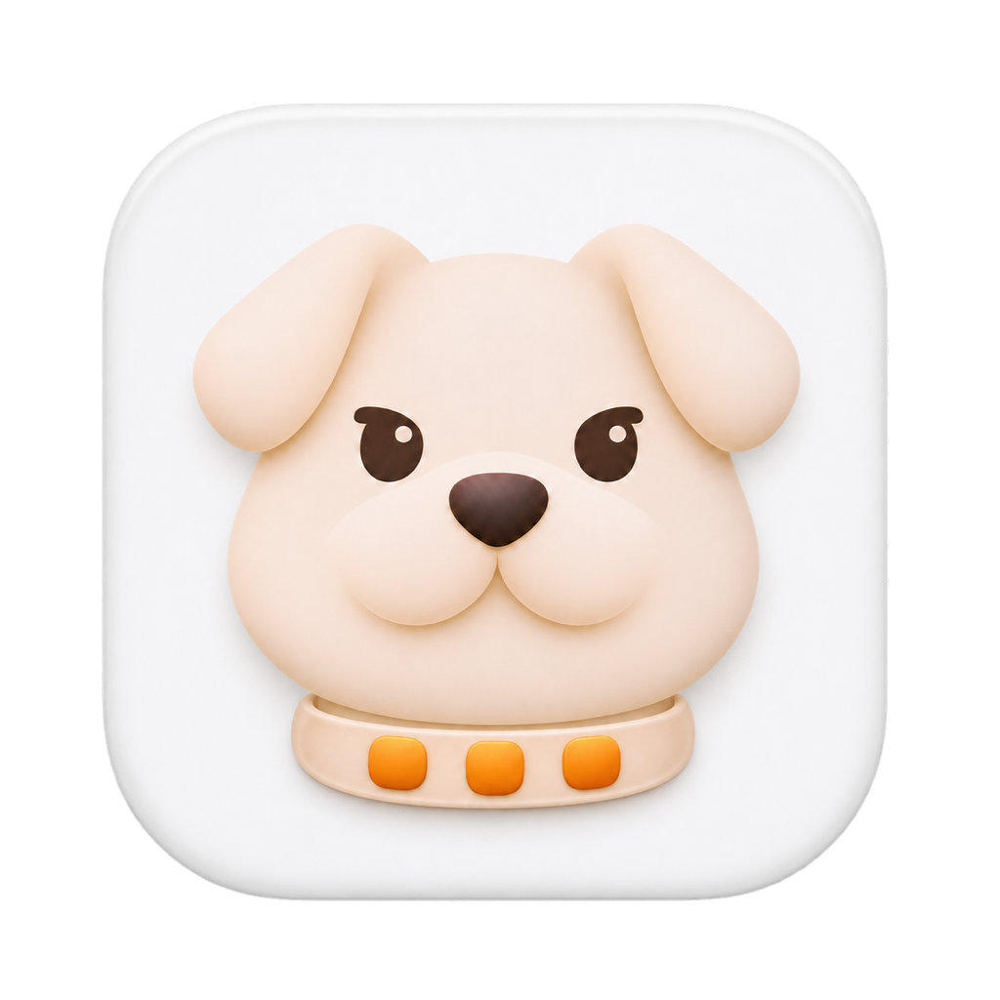

<p align="center">
  
</p>

# DockPup

让 macOS 系统 Dock 留在外接显示器上。

[English](README.md) · 简体中文

DockPup 是使用 Swift 和 AppKit 编写的轻量菜单栏应用，无第三方依赖。
适用于 MacBook 内屏与单个外接屏，尤其是外接屏位于内屏上方的排列。
断开外接屏后，内屏恢复正常的 Dock 行为。

**实验阶段：** Dock 迁入依赖光标自动移动与 macOS 的系统行为。
显示器重连或唤醒期间的恢复尽力而为，可能需要手动重试。

## 功能

- 输入空闲后，尝试将 Dock 迁入外接屏。
- 保护其他显示器暴露的底边，阻止 Dock 被鼠标触发而迁走。
- 在显示器变化、睡眠唤醒、解锁和 Dock 重启后重新检查位置。
- 通过菜单栏查看状态、拦截次数，暂停锁定或手动重试。

恢复时会短暂移动光标；移动或点击鼠标会中断当前动作，
输入再次空闲后可能重试。应用不修改 Dock 偏好设置或显示器排列。

## 轻量设计

- 原生 Swift 与 AppKit，无第三方运行时依赖。
- 采用事件驱动守护，确认 Dock 位置后没有轮询计时器。
- 计时器仅在恢复期间运行，恢复结束后停止。

实际 CPU、内存和能耗取决于输入活动、显示器配置与 macOS 版本。

## 使用条件

- 部署目标为 macOS 13 及以上。硬件行为仅在 Apple Silicon、macOS 26.5.2 上检查过；
  其他系统版本和 Intel Mac 尚未验证。
- 一个内置显示器与一个外接显示器。
- 系统 Dock 位置设为“底部”。
- 开启“显示器具有单独的空间”。
- 外接屏底边至少露出 8 个逻辑点。上下排列时，可在系统排列中稍微水平错开，
  让上屏的一段底边不与下屏共享。
- 为当前构建的 DockPup 授予辅助功能权限。

## 构建与运行

安装 Xcode 或 Apple Command Line Tools，需要 Swift 5.7 及以上。
项目已使用 Swift 6.2.4 在本机编译，无需安装额外依赖。

在仓库根目录运行：

```sh
bash scripts/build.sh
open .build/DockPup.app
```

重建前先退出正在运行的开发版本。脚本为当前 Mac 的架构编译，
从 `Resources/AppIcon.png` 生成 ICNS 图标，将许可证放入应用包，并进行临时签名。
生成的应用未经 Apple 公证。

## 初次设置

1. 暂停或退出其他 Dock 锁定工具。
2. 按上述条件设置 Dock、独立空间与显示器排列。
3. 打开菜单栏的显示器图标，选择 **Grant Accessibility Access…**。
4. 在“系统设置 → 隐私与安全性 → 辅助功能”中开启 DockPup。
   macOS 也可能弹出设备控制权限提示。
5. 点击 **Move Dock / Retry**，关闭菜单，静置输入约一秒。
   看到 **Dock confirmed on external display; guarding** 表示已确认 Dock 在外屏。

恢复完成后会尝试还原光标位置；如果期间收到真实输入，会放弃旧坐标，避免把光标拉回。

## 常见问题与限制

- **权限开关已开，仍提示授权：** 临时签名可能随构建变化。退出应用，在辅助功能中移除
  DockPup，重新添加当前 `.build/DockPup.app`、开启权限并重新运行。尽量保持应用路径一致。
- **Dock 没有迁入：** 核对使用条件，等显示器排列稳定后再重试。空闲等待上限 20 秒，
  单次移动上限 3 秒。无法读取位置或迁入失败时需要目视确认；编译成功不能替代实机验证。
- **底边操作受影响：** 非目标屏暴露底边的一条窄区域会改变光标行为，可能影响底边控件
  和触发角。共享边缘保留跨屏通行，拖动时放行；可通过 **Enable Locking** 暂停锁定。
- **系统设置中图标仍是占位图：** 退出并重新打开系统设置，再进入辅助功能页面刷新显示。

## 隐私

辅助功能权限用于读取 Dock 位置，以及拦截或发送鼠标事件。
恢复流程只检查距离上次按键的时间，不读取按键内容。
应用不记录原始输入、不将光标坐标写入磁盘，也不发起网络请求；日志仅包含状态与恢复原因。

## 参与贡献

开发结构、构建检查与实机验证步骤见英文 [贡献说明](CONTRIBUTING.md)。
GitHub Actions 检查编译与打包，Dock 的实际位置仍需要图形会话和真实显示器验证。
请遵守 [社区准则](CODE_OF_CONDUCT.md)；安全问题按 [SECURITY.md](SECURITY.md) 报告。

## 致谢与许可证

连续接近并推向底边的思路参考了
[DockDoor 的 DockLocker 实现](https://github.com/ejbills/DockDoor/blob/6d3c0db804bb4c5ef3ee1d2e31bfed2ec76b85a9/DockDoor/Utilities/DockLocker.swift)。

作者与维护者：[Gwokhou](https://github.com/gwokhov)。

Copyright © 2026 Gwokhou.

本项目采用 GNU 通用公共许可证第 3 版或任何后续版本（**GPL-3.0-or-later**）。
完整条款见英文 [LICENSE](LICENSE)，项目不提供担保。
